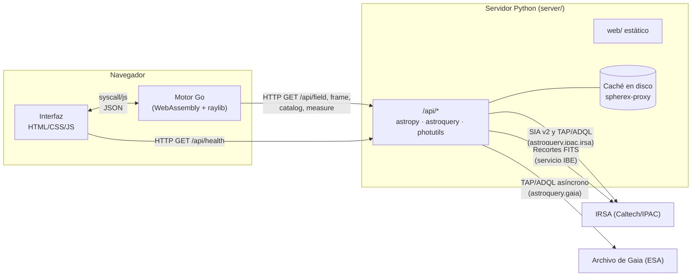
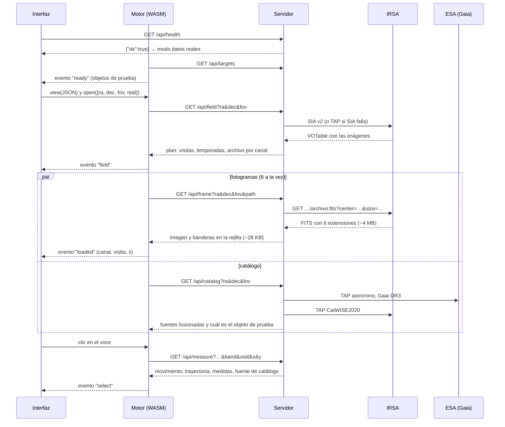

# Protocolos, transferencia de datos y arquitectura

Este documento describe cómo SPHEREx Sky Timeline obtiene, transporta, guarda y procesa los datos: qué servicios consulta, con qué protocolos, en qué formatos, cómo se reparten las peticiones y qué pasa cuando algo falla. Las operaciones numéricas (coordenadas, reproyección, fotometría…) están explicadas paso a paso, con datos reales, en el notebook [`operaciones.ipynb`](operaciones.ipynb).

## 1. Arquitectura



Hay tres piezas:

- **Interfaz** (`ui/`): buscador, canales, línea de tiempo, paneles. Es dueña del estado de la app (URL, reproducción, nivel) y lo envía al motor.
- **Motor** (Go compilado a WebAssembly, con raylib para el dibujo): pide al servidor el plan del campo y los fotogramas ya reproyectados, compone la imagen que toca (época, diferencia o suma), la colorea y la dibuja en un `<canvas>`. La composición se queda en el navegador porque se recalcula en cada fotograma de la reproducción. Al elegir una fuente, pide la medida al servidor y dibuja el resultado.
- **Servidor** (`server/`, Python): sirve la web y la API `/api/*`. Habla con IRSA y con el archivo de la ESA, lee los FITS, reproyecta, mide fotometría y movimiento, genera la simulación y guarda todo en una caché en disco.

| Archivo | Qué hace |
|---|---|
| `server/main.py` | HTTP, validación, rutas, precalentamiento. |
| `server/archive.py` | IRSA (SIA, TAP, recortes), Gaia DR3, CatWISE2020, fusión de catálogos, caché. |
| `server/science.py` | Rejilla, reproyección, banderas, estadística, fotometría, centroide, seguimiento, objetos de prueba. |
| `server/sim.py` | Simulación. |

### Por qué hace falta el servidor

Se comprobó desde un navegador real:

| Servicio | `Access-Control-Allow-Origin` | Desde el navegador |
|---|---|---|
| IRSA TAP, SIA y recortes | no se envía | bloqueado por CORS |
| Mirror de Sesame en Harvard | `*` | permitido (búsqueda por nombre) |

IRSA no permite peticiones desde otra web, así que el servidor hace de intermediario y sirve la app desde **el mismo origen** que la API: el navegador nunca hace peticiones entre orígenes a `/api`. Además:

- **La ciencia se hace con las librerías de referencia** (astropy, astroquery, photutils), las mismas de los tutoriales de IRSA.
- **Viaja mucho menos**: un recorte pesa ~4 MB (130–190 KB sin la PSF) y el motor recibe ~28 KB por fotograma.
- **Se cachea lo lento**: las consultas a IRSA tardan de segundos a minutos.

## 2. Flujo de una sesión



El motor empieza a descargar por las imágenes más cercanas a la cabeza de reproducción en el canal elegido, así que se puede reproducir antes de que termine la carga. La interfaz envía la vista (`view`) **antes** de abrir el campo para que esa prioridad sea correcta desde la primera petición. La medida usa los fotogramas que el servidor ya sirvió; mientras llegan más, el motor la vuelve a pedir como mucho una vez por segundo.

## 3. Protocolos y servicios externos

### 3.1 HTTP

Todo viaja por HTTPS hacia fuera y por HTTP/1.1 local entre navegador y servidor. El navegador abre como mucho 6 conexiones por servidor, así que el motor limita sus descargas a 6 en paralelo para no hacer cola en el navegador.

### 3.2 IVOA SIA v2: lista de imágenes (vía principal)

Simple Image Access devuelve las imágenes que contienen una posición. Es la vía que usa el tutorial de introducción de IRSA, con astroquery:

```python
Irsa.query_sia(pos=(SkyCoord(ra, dec, unit='deg'), 0.0003 * u.deg),
               collection=['spherex_dr1', 'spherex_qr3'])
```

- **Respuesta**: una tabla de astropy (VOTable por debajo). Se usan `access_url` (URL del archivo) y `t_min` (MJD de inicio).
- **Tiempo observado**: de 2 a 5 s.
- **Limitación**: SIA ve los datos nuevos con alrededor de un día de retraso respecto a TAP (la ingesta es semanal).

### 3.3 IVOA TAP con ADQL: lista de imágenes (respaldo) y CatWISE

Table Access Protocol en modo síncrono (`Irsa.query_tap(adql).to_table()`).

Imágenes SPHEREx que contienen un punto (la consulta del tutorial de recortes):

```sql
SELECT a.uri, p.time_bounds_lower
FROM spherex.artifact a
JOIN spherex.plane p ON a.planeid = p.planeid
WHERE 1 = CONTAINS(POINT('ICRS', <ra>, <dec>), p.poly)
ORDER BY p.time_bounds_lower
```

CatWISE2020 en un cono de 0.15°:

```sql
SELECT source_name, ra, dec, pmra, pmdec, w2mpro FROM catwise_2020
WHERE 1 = CONTAINS(POINT('ICRS', ra, dec), CIRCLE('ICRS', <ra>, <dec>, 0.15))
  AND (w1mpro < 15.5 OR w2mpro < 16.5)
```

TAP tarda de 30 s a varios minutos. Se usa para las imágenes solo si SIA falla (a cambio ve los datos del último día), y para CatWISE, que no tiene otra vía.

**Deduplicación de imágenes** (SIA y TAP): una misma exposición y detector puede aparecer reprocesada (`_retry`) o en dos entregas (QR3 y DR1). Del nombre `level2_<exposición>D<detector>_spx…` se saca la clave; si hay varias, se queda la de DR1 y, dentro de ella, la última por ruta.

**Estructura de las exposiciones**: en cada exposición un punto del cielo cae en **una pareja de detectores** (D1+D4, D2+D5 o D3+D6), porque los dos planos focales ven el mismo cielo a través del divisor dicroico. Una visita es una exposición; los otros cuatro canales no tienen imagen en ella. Las visitas separadas por más de 40 días empiezan una nueva temporada (pasada del survey).

### 3.4 Servicio de recortes de IRSA (IBE)

Cada imagen de SPHEREx (2040×2040 píxeles por detector) se puede pedir recortada añadiendo parámetros a su URL:

```
GET https://irsa.ipac.caltech.edu/ibe/data/spherex/<entrega>/level2/<semana>/<versión>/<detector>/<archivo>.fits
    ?center=<ra>,<dec>d&size=<lado en grados>
```

- **Lado del recorte**: el recorte llega en la orientación del detector, rotado respecto al norte, así que debe cubrir las esquinas del campo norte-arriba en cualquier ángulo: `lado = campo × √2 × 1.02`. Para un campo de 6′ son 0.144° (unos 84 píxeles).
- **Contenido**: un FITS multiextensión con `PRIMARY`, `IMAGE`, `FLAGS`, `VARIANCE`, `ZODI`, `EPSF` y `WCS-WAVE`.
- **Tamaño**: `EPSF` es un cubo de PSF de unos 3.9 MB (el 97 % del archivo) que no se usa. **El servidor lo elimina** con `astropy.io.fits` antes de guardar el recorte, que pasa de ~4 MB a ~130–190 KB.

### 3.5 FITS y reproyección

Los recortes se leen con `astropy.io.fits`. Extensiones y palabras clave que se usan:

| Extensión | Contenido | Uso |
|---|---|---|
| `IMAGE` (float32) | Brillo superficial en MJy/sr | Imagen. `MJD-AVG` da la fecha; el WCS principal (TAN-SIP) da la posición; el alternativo `W` (`WAVE-TAB`) da la longitud de onda. |
| `FLAGS` (int32) | Máscara de bits por píxel | Bit *n* nombrado por `MSKNnnnn` y descrito por `MSKDnnnn`. |
| `VARIANCE` (float32) | Varianza por píxel, (MJy/sr)² | Errores de la fotometría. |
| `ZODI` (float32) | Modelo de luz zodiacal, no restado | Se resta para igualar el fondo entre visitas. |
| `EPSF` | PSF efectiva | Eliminada por el servidor. |
| `WCS-WAVE` (tabla binaria) | Rejilla 9×9 de puntos de control con (λ, ancho de banda) | Longitud de onda de cada píxel. |

**Reproyección** (`science.process`): todas las imágenes se llevan a la misma rejilla, una proyección TAN centrada en el campo, de 6.15″ por píxel, con el norte arriba y el este a la izquierda. Para cada píxel de la rejilla se busca su posición en el recorte con `astropy.wcs` (`all_world2pix`, que aplica la distorsión SIP), se interpola bilinealmente `IMAGE − ZODI` y `VARIANCE` saltando los píxeles no finitos, y las banderas se toman del píxel más cercano. Lo que cae fuera del recorte queda como `MISSING_DATA`. La longitud de onda sale de `WCS(cabecera, fobj=hdul, key='W')` sin la distorsión, como indica el tutorial `spherex_intro`.

### 3.6 Gaia DR3 (archivo de la ESA)

Las fuentes de Gaia DR3 con G < 19 en el cono de 0.15° se piden con `astroquery.gaia` al TAP del archivo de la ESA:

```sql
SELECT source_id, ra, dec, pmra, pmdec, phot_g_mean_mag FROM gaiadr3.gaia_source_lite
WHERE 1 = CONTAINS(POINT(ra, dec), CIRCLE(<ra>, <dec>, 0.15)) AND phot_g_mean_mag < 19
```

- **Tabla `gaia_source_lite`**: tiene las columnas necesarias y responde antes que `gaia_source`.
- **Consulta asíncrona** (`launch_job_async`): la síncrona se corta en 2000 filas y caduca en los campos densos. En el bulbo galáctico el cono trae unas 49 000 fuentes en ~14 s; en Barnard, unas 1900 en ~8 s.
- Los movimientos propios `null` se guardan como 0.

Antes el proyecto descargaba los archivos masivos del CDN de la ESA (3386 archivos de ~230 MB) y los partía en teselas HEALPix; una zona nueva tardaba de 1 a 6 minutos.

### 3.7 Sesame (búsqueda por nombre)

La interfaz resuelve nombres de objetos con Sesame (CDS) directamente desde el navegador:

```
GET https://vizier.cfa.harvard.edu/viz-bin/nph-sesame/-oI/SNV?<nombre>
```

Si falla, prueba con `vizier.idia.ac.za` (cada intento tiene 5 s de límite). La URL principal de CDS redirige sin cabeceras CORS, así que se usan los mirrors directamente. De la respuesta en texto se leen `%J` (posición J2000) y `%P` (movimiento propio), que se usa para llevar la posición a la fecha actual.

## 4. Comunicación entre la interfaz y el motor

El motor corre en el mismo hilo que la página. Su bucle de dibujo cede el control en cada fotograma (`EndDrawing` espera a `requestAnimationFrame`), y en ese momento se ejecutan las llamadas de JavaScript. Las llamadas no tocan el estado del motor directamente: encolan una función (`App.Post`) que el bucle ejecuta al principio del siguiente fotograma.

**De la interfaz al motor** (`globalThis.skyEngine`, argumentos JSON en texto):

| Función | Argumentos | Efecto |
|---|---|---|
| `open(json)` | `{ra, dec, fov, name, real}` | Abre un campo; `real: false` pide la simulación. |
| `view(json)` | `{band, mode, visit, ref, flags, catalog, tint}` | Canal (0–5), modo (`epoch`/`diff`/`sum`), visita, referencia (−1 automática) y capas. |
| `zoom(f)`, `fit()` | factor | Zoom del visor. |
| `resize(w, h)` | píxeles | Tamaño del canvas. |
| `pointer(dentro)` | booleano | Si el puntero está sobre el canvas (el backend web de raylib no lo detecta). |
| `clearSelection()` | — | Quita la fuente seleccionada. |

**Del motor a la interfaz** (`globalThis.skyUI.event(tipo, json)`):

| Evento | Contenido |
|---|---|
| `ready` | Los 5 objetos de prueba con posición actual y canal y modo sugeridos (de `/api/targets`). |
| `status` | Fase (`visits`, `catalog`), estado (`loading`, `done`, `empty`, `error`), error, número de elementos y catálogos que faltaron. |
| `field` | Visitas (fecha, temporada, sub-banda), disponibilidad por canal, tamaño, si es real y unidad de flujo. |
| `loaded` | Imágenes recién cargadas: canal, visita, λ en el centro y si se pudo leer. Incluye el progreso total. |
| `frame` | La imagen mostrada: fecha, λ, referencia usada, archivo, fondo, ruido, píxeles marcados y número de imágenes apiladas. |
| `hover` | Píxel bajo el cursor: coordenadas, valor y banderas. |
| `select` | La respuesta de `/api/measure` tal cual: posición, movimiento propio con errores, trayectoria, todas las medidas (canal, visita, λ, flujo, error, fiable) y la fuente de catálogo que coincide. |

## 5. API del servidor

Todas las respuestas de `/api/*` llevan `Access-Control-Allow-Origin: *`. Los errores son JSON `{"error": "…"}` con estado 400 (parámetros inválidos), 404 (no existe), 422 (recorte ilegible) o 502 (falló un servicio externo).

Los campos se identifican con `ra`, `dec` (grados) y `fov` (minutos de arco, de 4 a 12). Un campo simulado lleva además `sim=1` y `now`, el día (MJD) para el que se planificó, que devuelve `/api/field`: así cada petición posterior ve el mismo calendario. Las coordenadas de píxel siguen la convención del motor: el píxel *i* cubre [*i*, *i*+1).

| Método y ruta | Parámetros | Respuesta | Caché |
|---|---|---|---|
| `GET /api/health` | — | `{"ok":true}` | — |
| `GET /api/targets` | — | `[{id, name, aliases, ra, dec, pmra, pmdec, band, mode}]` en la posición de hoy | — |
| `GET /api/field` | campo | `{real, ra, dec, npix, target, name, fluxUnit, now?, visits: [{mjd, season, sub}], files: [6][visitas]}`; `files` tiene la ruta del archivo o `""` si ese canal no tiene imagen en esa visita | lista de imágenes 24 h |
| `GET /api/frame` | campo y `path` (real) o `c`, `v` (simulado) | Binario (sección 6) | Permanente; `Cache-Control: immutable` en los reales |
| `GET /api/catalog` | campo | `{sources: [{catalog, name, ra, dec, pmra, pmdec, mjd, mag}], target, missing}` | Gaia y CatWISE, permanentes |
| `GET /api/measure` | campo, `band`, `visit`, `x`, `y` | `{ra, dec, band, moving, pmra, pmdec, pmraErr, pmdecErr, x0, y0, t0, vx, vy, track: [{v, x, y}], measurements: [{c, v, t, l, f, e, ok}], catalog}` | — |
| `GET /api/visits` | `ra`, `dec` | `{ra, dec, source: "SIA"\|"TAP", fetched, visits: [{path, mjd, detector, exposure, release}]}` | 24 h; `X-Cache: HIT\|MISS` |
| `GET /api/cutout` | `path`, `ra`, `dec`, `size` (≤ 0.3°) | FITS (`application/fits`) sin `EPSF` | Permanente |
| `GET /…` | — | Archivos de `web/` | `Cache-Control: no-cache` (una recompilación se ve al recargar) |

Unidades: `pmra` y `pmdec` en mas/año en el catálogo (`pmra` incluye cos δ) y en ″/año en la medida; `mjd` del catálogo es la época de la posición (57388.5 = J2016.0 para Gaia, 57170.0 = 2015.4 para CatWISE); `mag` es G (Gaia) o W2 (CatWISE). En la medida, `f` y `e` van en mJy (unidades propias en la simulación) y `l` en µm. `target` es el índice del objeto de prueba en `sources`, o −1.

**Validación**: `path` debe empezar por `ibe/data/spherex/`, terminar en `.fits` y no contener `..`, `?`, `#` ni `\`. Así el servidor no sirve para pedir cualquier otra cosa a IRSA ni a otros servidores.

## 6. Formatos

**Fotograma para el motor** (`/api/frame`): binario little-endian, sin compresión.

| Bytes | Contenido | Tipo |
|---|---|---|
| 0–39 | MJD, λ en el centro (µm), fondo, σ, sub-banda | 5 × float64 |
| 40 … | Imagen N×N, fila a fila, norte arriba | float32 |
| … | Banderas N×N | uint32 |

Para un campo de 6′ (N = 59) son 27 888 bytes.

**Fotograma en caché**: un `.npz` de numpy con la imagen, las banderas, la varianza y la longitud de onda de cada píxel; la medida lo lee de ahí sin volver a reproyectar.

## 7. Caché

Todo vive en `~/Library/Caches/spherex-proxy` en macOS o `~/.cache/spherex-proxy` en Linux (o en la carpeta indicada con `--cache`). Es la misma carpeta y el mismo esquema de claves que usaba el proxy en Go, así que las listas de imágenes, los recortes y CatWISE que ya estaban guardados se aprovechan. La carpeta `gaia/` de esa versión ya no se usa y se puede borrar.

| Qué | Clave | Validez |
|---|---|---|
| Lista de imágenes | `visits <ra> <dec>` | 24 h (IRSA añade datos cada semana) |
| Recorte sin EPSF | `cutout <path> <ra> <dec> <size>` | permanente (la ruta incluye la versión de procesado) |
| Fotograma reproyectado | `frame1 <path> <ra> <dec> <fov>` | permanente (`frame1` cambia si cambia el procesado) |
| Gaia DR3 | `gaia <ra> <dec> 0.150` | permanente |
| CatWISE | `catwise <ra> <dec> 0.150` | permanente |

- **Ubicación de las entradas**: `<sha256(clave)[:2]>/<sha256(clave)>`.
- **Escritura atómica**: archivo temporal y `os.replace`, así una caída nunca deja medio archivo.
- **Peticiones simultáneas**: si llegan varias con la misma clave, la consulta se hace una sola vez y las demás esperan su resultado.
- **En memoria**: los últimos 3000 fotogramas leídos y 3000 simulados, para que la medida no relea el disco.
- **Redondeo**: las posiciones se redondean a 0.0005° (1.8″), en el servidor y en el motor. La posición actual de un objeto rápido, como WISE 0855 a 8″/año (0.022″/día), cambia el sexto decimal del centro (0.0036″) cada ~4 horas; sin redondeo la clave de cada recorte cambiaría varias veces al día y casi nunca coincidiría con las del precalentamiento. Con 1.8″ la clave dura unas 11 semanas.

## 8. Concurrencia

El servidor atiende cada conexión en su propio hilo. Cada tipo de petición externa tiene sus propios turnos, para que lo lento no bloquee lo urgente:

| Dónde | Límite | Motivo |
|---|---|---|
| Motor → servidor (fotogramas) | 6 a la vez | Conexiones por servidor del navegador. |
| Servidor → IRSA (recortes) | 8 (`--parallel`) | Los tutoriales de IRSA recomiendan de 7 a 12. |
| Servidor → IRSA (listas de imágenes) | 2 | Camino crítico de la app; consultas pesadas. |
| Servidor → IRSA (CatWISE) | 2 | Muy lentas; no deben ocupar los turnos de lo anterior. |
| Servidor → ESA (Gaia) | 1 | El cliente de astroquery guarda el estado de la última respuesta. |
| Motor → servidor (medida) | 1, como mucho una por segundo | Se repite mientras llegan fotogramas o el catálogo. |

- **Peticiones abandonadas**: una descarga empezada sigue hasta el final para que el resultado quede en caché, aunque el navegador ya no espere.
- **Precalentamiento**: al arrancar, el servidor pide en serie las listas de imágenes y luego los catálogos de los 5 objetos de prueba, para no saturar los servicios.

## 9. Tolerancia a fallos

| Capa | Qué se reintenta | Cómo |
|---|---|---|
| Servidor → IRSA y ESA | Errores de red y respuestas 5xx | 3 intentos, con esperas de 1 s y 2 s. Los 4xx no se reintentan. |
| Motor → servidor | Fotogramas con error transitorio (red o 5xx) | Vuelven a la cola tras 20, 40, 80 y 160 s; después quedan como hueco en la línea de tiempo. |
| Listas de imágenes | SIA caído | Se repite la consulta por TAP. |
| Catálogo | CatWISE lento o caído | Se espera como mucho 20 s tras tener Gaia; se responde con Gaia y `missing: ["CatWISE2020"]`, y CatWISE sigue en segundo plano para la próxima vez. |

Plazos: 90 s sin datos para un recorte y 10 minutos sin datos para cualquier otra conexión (las consultas TAP pueden tardar minutos antes del primer byte).

Un recorte ilegible (FITS corrupto o sin las extensiones necesarias) no se reintenta: el servidor responde 422 y el motor lo marca como hueco. Los errores llegan a la interfaz como estados (`status`) con mensajes en lenguaje llano y la opción de pasar a la simulación.

## 10. Rendimiento observado

| Operación | Tiempo o tamaño |
|---|---|
| SIA, lista de imágenes | 2–5 s (358 imágenes para Barnard) |
| TAP, lista de imágenes | 27–58 s |
| TAP, CatWISE | ~130 s, con frecuentes 502 durante las pruebas |
| TAP de la ESA, Gaia DR3 | ~8 s en Barnard, ~14 s en el bulbo galáctico |
| Recorte de 6′ | 0.7–1.4 s en condiciones normales; 10–90 s con IRSA degradado |
| Reproyección de un recorte | ~50 ms la primera vez; después sale de la caché |
| Fotograma que recibe el motor | 28 KB (6′) frente a 130–190 KB del recorte sin EPSF |
| Medida de una fuente | 0.2–0.7 s con 100–300 fotogramas |
| Cualquier respuesta cacheada | milisegundos |

## 11. Convenciones

- **Coordenadas**: ICRS en grados. La rejilla del campo va con el norte arriba y el este a la izquierda, a 6.15″ por píxel. En la API y en el motor el píxel *i* cubre [*i*, *i*+1); dentro del servidor se usa la convención de astropy y photutils (el centro del píxel *i* en *i*).
- **Tiempo**: MJD. Épocas de referencia: J2000 (posiciones de los objetos de prueba, de Simbad), J2016.0 (Gaia DR3) y MJD 57170 (CatWISE2020).
- **Unidades**:
  - Imágenes en MJy/sr.
  - Fotometría en mJy: suma en la apertura × ángulo sólido del píxel en sr × 10⁹.
  - Longitudes de onda en µm.
  - Movimientos propios en mas/año en los catálogos y en ″/año en la medida y la interfaz.

La simulación usa las mismas estructuras y bits de banderas que los datos reales, así que todo el código posterior (composición, fotometría, seguimiento) es común.
